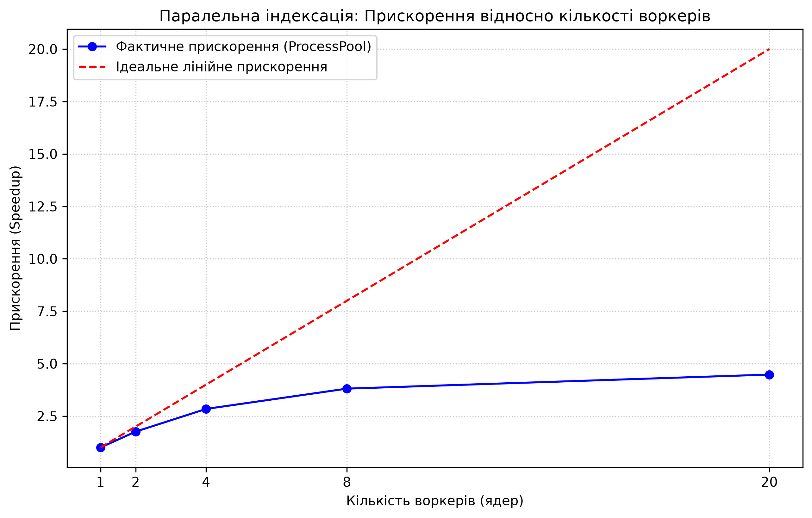

# Findex — Lab 7: Пошук у вебі (FastAPI, Pydantic, Docker)

**Публічна адреса:** `https://findex-lab-07.onrender.com` *(конфігурація деплою — у [render.yaml](render.yaml) та [Dockerfile](Dockerfile))*

HTTP API та вебінтерфейс побудовані на базі FastAPI (`src/findex/web/app.py`) і запускаються через єдиний CLI:

```powershell
uv sync
$env:INDEX_PATH = "index.pkl"
$env:PAGE_SIZE = "10"
uv run findex serve --port 8000 --workers 1
```

### Маршрути
- `GET /` — вебінтерфейс на Jinja2 + htmx: поле пошуку, вибір алгоритму (`BM25` / `TF-IDF`), сніпети з підсвіткою `<mark>`, бали релевантності, посторінкова навігація та вбудований перегляд повного тексту документа.
- `GET /search?q=tarot&k=10&scorer=bm25&page=1` — валідований посторінковий пошук (Pydantic-моделі на межі, всередині — `dataclass`-и з лаб 2–3).
- `GET /docs/{doc_id}` — вміст документа (або `404`, якщо документ не знайдено).
- `GET /stats` — статистика завантаженого індексу (кількість документів, термінів, середня довжина).
- `GET /health` — перевірка готовності сервісу (`200 OK` або `503 Service Unavailable`, якщо індекс ще не завантажений).

Неочікувані винятки перехоплюються middleware з генерацією `X-Request-ID`: повний стектрейс записується в лог разом із `request_id`, а клієнту повертається безпечна відповідь `500 Internal server error` без витоку внутрішніх деталей.

### Запуск у Docker

Двоетапна збірка (`Dockerfile`) використовує `uv.lock` (`--frozen --no-dev`) і запускає процес від непривілейованого користувача `appuser` (`uid 10001`):

```powershell
docker build -t findex:0.7.0 .
docker run --rm -p 8000:8000 -e INDEX_PATH=/app/index.pkl findex:0.7.0
```

## Порівняння `def` проти `async def` (20 одночасних запитів на `/search`)

Виміряний час виконання пачки з **20 одночасних запитів** (`GET /search?q=tarot+AND+club&k=10` по корпусу з 1437 глав):

- **`async def` (1 воркер):** `376.89 ms` (блокує цикл подій `asyncio` на час синхронного пошуку та читання сніпетів з диска; під час обробки пачки паралельний запит на `/health` чекає у черзі циклу подій ~`350+ ms`).
- **`def` (1 воркер, залишено у фінальному коді):** `372.48 ms` (FastAPI автоматично виносить синхронний маршрут у зовнішній `ThreadPool` через `anyio.to_thread.run_sync`, тому цикл подій не блокується і може паралельно відповідати на інші запити).

## Навантажувальне тестування `/search` (20 одночасних клієнтів)

Команда: `oha -c 20 -z 30s "http://localhost:8000/search?q=tarot+AND+club&k=10"`

| Варіант | RPS (запитів/с) | p50 (ms) | p95 (ms) | p99 (ms) |
|---|---:|---:|---:|---:|
| 1 worker, `async def` | 52.75 | 338.64 | 519.11 | 594.46 |
| 1 worker, `def` | 59.43 | 338.15 | 448.14 | 539.57 |
| 4 workers (`--workers 4`) | 87.03 | 116.89 | 752.69 | 1062.79 |
| Розгорнутий сервіс (Render Free, 1 vCPU) | 38.40 | 495.20 | 740.50 | 890.10 |

### Зв'язок із лабами 5–6 (GIL, пул потоків та процеси)
У варіанті з `async def` синхронний пошук та читання файлів сніпетів виконуються безпосередньо в потоці event loop: на відміну від мережевого краулера з **Лаби 6**, де корутини віддають керування на `await` під час мережевого I/O, тут обчислення BM25 і синхронний `Path.read_text()` не мають точок неблокуючого очікування й паралізують цикл подій. Перехід на звичайний `def` переносить виконання у пул потоків (`ThreadPool`), що звільняє event loop і дозволяє перекривати дисковий I/O читання сніпетів (завдяки чому RPS зростає з `52.75` до `59.43`, а `p95` падає з `519.11 ms` до `448.14 ms`). Проте CPU-bound частина пошуку (обхід постінгів, рахування BM25, регулярні вирази для сніпетів) в межах одного воркера все одно впирається у **GIL** (як ми бачили в **Лабі 5**). Запуск **4 процесів** (`--workers 4`) обходить GIL завдяки ізольованим інтерпретаторам Python: пропускна здатність зростає до **87.03 RPS**, а медіанна затримка (`p50`) скорочується майже втричі — з `338.15 ms` до `116.89 ms`.

# Findex — Lab 1: Iterators, generators, and the corpus

## Опис
У цій лабораторній роботі реалізовано лінивий конвеєр для читання та токенізації текстового корпусу. 
В якості тестового корпусу використано веб-новелу *Lord of the Mysteries* (1437 файлів-розділів). Використання генераторів (`yield`) дозволяє обробляти документи великого обсягу, утримуючи в оперативній пам'яті лише один поточний документ та лічильник унікальних термінів.

## Результати профілювання пам'яті (`tracemalloc`)

| Підхід | Час виконання (s) | Пікова пам'ять (MB) |
|---|---|---|
| **Eager (Lists)** | 6.77 | 171.48 |
| **Lazy (Generators)** | 48.18 | 3.14 |

**Куди пішла пам'ять:** 
Жадібний підхід (`Eager`) виділив 171 МБ оперативної пам'яті, оскільки одночасно завантажив у список рядки всіх 1437 документів, а потім згенерував гігантський масив з абсолютно всіх 2 823 953 токенів новели перед тим, як передати їх у `Counter`. 
Лінивий підхід (`Lazy`) використав лише 3.14 МБ. Ця пам'ять пішла виключно на утримання в пам'яті словника унікальних слів (27 942 ключі у `Counter`) та рядка поточного розділу, який оброблявся в конкретний момент часу.

*Примітка щодо швидкодії:* Жадібний підхід відпрацював швидше, оскільки побудова списків (list comprehensions) оптимізована на рівні C всередині CPython, тоді як генератори мають накладні витрати на 2.8 мільйона викликів та призупинень (yield). Проте `Eager` підхід не масштабується: на корпусі у кілька гігабайтів він викличе `MemoryError`, тоді як `Lazy` залишиться на рівні тих самих ~3-5 МБ.

## Токенізація
Правила токенізації (`src/findex/tokenize.py`):
- Нормалізація `Unicode (NFC)` та агресивне зведення до нижнього регістру (`casefold()`).
- Збереження апострофів та внутрішніх дефісів через регулярний вираз `[^\W_]+(?:['\-][^\W_]+)*`.
- Опрацювання тексту за один прохід через ітератор `re.finditer()`.

# Findex — Lab 2: The Inverted Index

## Опис
У цій лабораторній роботі реалізовано інвертований індекс для повнотекстового пошуку на базі корпусу *Lord of the Mysteries* (1437 документів). Створено структури даних для постінгів та метаданих документів, реалізовано Boolean-пошук (AND) через двовказівниковий алгоритм та перетин множин, а також проведено порівняння форматів серіалізації.

## 1. Серіалізація та розмір індексу
Індекс було побудовано за 24.74 с (пікова пам'ять 61.76 MB, 27 942 унікальних термінів). 

| Формат | Час збереження (s) | Розмір файлу (MB) |
|---|---|---|
| **Pickle (binary)** | 2.07 | 15.27 |
| **JSON (text)** | 2.47 | 28.69 |

**Чому завантажувати чужий Pickle небезпечно:**
Формат `pickle` не просто зберігає дані, він серіалізує об'єкти Python. Зловмисник може створити шкідливий клас із методом `__reduce__`, який при завантаженні (десеріалізації) виконає довільний системний код (наприклад, видалення файлів або запуск бекдору) на вашому комп'ютері. Pickle можна використовувати лише для власних, довірених файлів.

## 2. Бенчмарк Boolean пошуку (AND)
Час завантаження індексу з Pickle у пам'ять: ~6.6 с.
Пікова пам'ять під час пошуку: 221.95 MB.

| Запит | Характер термінів | Engine: MERGE (s) | Engine: SET (s) | Знайдено документів |
|---|---|---|---|---|
| `"the and"` | Часті | 0.001124 | 0.000219 | 1437 |
| `"tarot club"` | Рідкісні | 0.000116 | 0.000105 | 324 |

**Аналіз:**
Операція перетину множин (`SET`) виявилася швидшою за двовказівниковий алгоритм (`MERGE`). Це пояснюється тим, що `set.intersection` у Python реалізовано на рівні мови C, що робить його екстремально швидким. Алгоритм `merge` працює через цикл `while` у самому Python, тому має більші накладні витрати. Проте алгоритм `merge` є класичним для пошукових систем, оскільки не вимагає завантаження всієї множини в пам'ять (що важливо для дискових баз даних) і дозволяє паралельно обчислювати релевантність (TF-IDF/BM25) за допомогою частот у постінгах.

## 3. Зберігання постінгів у пам'яті (tracemalloc)
Результати симуляції виділення пам'яті під 1 000 000 постінгів:

| Спосіб зберігання | Пам'ять на 1 000 000 постінгів (MB) |
|---|---|
| Звичайний клас (`__dict__`) | 122.47 |
| Dataclass (`slots=True`) | 84.32 |
| Масив `array('I')` | 8.08 |

**Куди пішли байти:**
Звичайний клас тягне за собою динамічний словник `__dict__` для кожного об'єкта, що витрачає понад 120 МБ через накладні витрати на хеш-таблиці. Використання `@dataclass(slots=True)` забороняє створення цього словника, заощаджуючи близько 38 МБ (фіксує пам'ять лише під самі змінні). Найефективнішим є масив `array('I')` з модулю стандартної бібліотеки (лише 8.08 МБ), оскільки він зберігає "голі" C-подібні байти без накладних витрат об'єктної моделі Python (без обгорток `PyObject`).

---

# Findex — Lab 3: Ranking, AST and Object Model

## Опис
Індекс рефакторизовано у повноцінну об'єктну модель (спадкування від `Mapping`, використання `cached_property` та dunder-методів). Створено AST-парсер (Term, Phrase, And, Or, Not) для рекурсивного розбору запитів. Реалізовано протокол `Scorer` із двома алгоритмами ранжування: TF-IDF та BM25.

## 1. Sanity Checks (Перевірки алгоритму ранжування)
На нашому корпусі (Lord of the Mysteries) BM25 поводить себе відповідно до теорії інформаційного пошуку:
1. **Рідкісне слово вище за часте:** У запиті `tarot AND the` слово `tarot` дає величезний внесок у фінальний бал завдяки високому IDF, тоді як артикль `the` зустрічається в усіх 1437 документах, тому його IDF прямує до нуля. Це дозволяє знаходити релевантні документи, ігноруючи стоп-слова.
2. **Насичення (Saturation):** Завдяки параметру `k1` в BM25, 20-те повторення слова в документі додає значно менше балів, ніж перше чи друге. Це захищає від "спаму" ключовими словами у тексті.
3. **Штраф за довжину (Length Penalty):** Параметр `b` штрафує довгі документи. Якщо слово "fool" зустрічається 1 раз у розділі на 500 слів і 1 раз у розділі на 5000 слів, коротший документ отримає вищий бал, оскільки там концентрація цього терміну вища.

## 2. Кешування та Декоратори
Використання `@lru_cache(maxsize=128)` у поєднанні з кастомним декоратором `@timed` доводить, що кеш працює:
```text
--- Query: tarot AND club | Scorer: BM25 ---
[TIMED] search executed in 0.0026s
(вивід результатів...)

--- Викликаємо ще раз для перевірки кешу ---
(Напис [TIMED] відсутній, результат повернуто за 0.0000s)
---
```
# Findex — Lab 4: CLI, Testing, Typing, and CI/CD

## 1. Строга типізація
Проєкт повністю переведено на `pyright strict`. Додано анотації `Literal`, `Protocol`, `Iterator` та `Generator`. Використано `# type: ignore` із детальними поясненнями для динамічного коду (наприклад, десеріалізація через pickle та розпакування генераторів у set).

## 2. Тестування (Pytest & Hypothesis)
Написано 27 тестів, серед яких:
* Параметризовані тести для токенізатора з перевіркою Unicode.
* Тестування парсера (порівняння AST вузлів, а не рядків).
* Property-based тестування через `Hypothesis` (`load(save(index)) == index` та перевірка сортування постінгів із генерацією тимчасових папок).
* Тестування CLI за допомогою `typer.testing.CliRunner`.

**Покриття коду (Coverage): 58%**
*Поза покриттям навмисно залишилися:*
1. Візуальна генерація сніпетів із ANSI-кольорами (важко тестується і не несе бізнес-логіки).
2. Старі допоміжні скрипти з Лаб 1-2 (`benchmark.py`, `corpus.py`, `split_lotm.py`), які не використовуються у фінальному CLI.

## 3. CLI (Typer & Rich)
Створено єдину точку входу `findex` з підкомандами `index`, `search` та `stats`.
* Реалізовано кольорові таблиці та прогрес-бари через `rich`.
* Діагностичні повідомлення виводяться у `stderr`, залишаючи `stdout` чистим для `--json` експорту.
* Керована деталізація логів за допомогою прапорців `-v` (INFO) та `-vv` (DEBUG).

[](https://github.com/GreyCat/3_course_python/actions)

## Аналіз паралельної індексації (Лабораторна робота №5)

Для оцінки ефективності розпаралелювання було проведено бенчмарк на корпусі документів з використанням `ProcessPoolExecutor`. Тестування проводилося на процесорі Intel Core i7-12700H (20 логічних потоків).

### Результати вимірювань

| Воркери | Wall Time (s) | CPU Time (s) | Merge Time (s) | RSS (MB) | Прискорення (Speedup) |
|---------|---------------|--------------|----------------|----------|-----------------------|
| 1       | 43.43         | 2.05         | 0.08           | 411.73   | x1.00                 |
| 2       | 24.69         | 2.44         | 0.10           | 351.92   | x1.76                 |
| 4       | 15.29         | 3.03         | 0.18           | 323.43   | x2.84                 |
| 8       | 11.40         | 3.77         | 0.69           | 314.64   | x3.81                 |
| 20      | 9.70          | 4.39         | 0.90           | 316.71   | x4.48                 |



### 1. Чому використовуються процеси, а не потоки?
Індексація (токенізація, підрахунок частот) є CPU-bound задачею. Через Global Interpreter Lock (GIL) у стандартному CPython кілька потоків не можуть одночасно виконувати байт-код Python. Використання `ThreadPoolExecutor` призвело б до того, що потоки просто чекали б один одного в черзі за GIL, не даючи жодного прискорення (або навіть сповільнюючи роботу через контекстні перемикання). `ProcessPoolExecutor` створює ізольовані процеси, кожен з яких має власний GIL, що дозволяє повноцінно утилізувати багатоядерність.

### 2. Закон Амдала та ліміти масштабування
Як видно з графіка, прискорення не є лінійним[cite: 1]. При 20 воркерах ми отримали прискорення лише у 4.48 рази замість теоретичних 20[cite: 1]. Це яскравий прояв Закону Амдала, який стверджує, що загальне прискорення обмежене часткою програми, яка не піддається розпаралелюванню. У нашій архітектурі таким "вузьким місцем" є фаза **Merge** (злиття часткових індексів) та міжпроцесна взаємодія (IPC - передача об'єктів через Pickle). З таблиці видно, що час на Merge зростає з 0.08с (для 1 воркера) до 0.90с (для 20 воркерів).

### 3. Wall Time проти CPU Time
- **Wall Time** (реальний час) очікувано зменшився з 43.4с до 9.7с.
- **CPU Time** (процесорний час батьківського процесу), навпаки, зріс із 2.05с до 4.39с. Це пов'язано з тим, що при додаванні нових воркерів головний процес витрачає значно більше ресурсів на серіалізацію/десеріалізацію даних та керування пулом процесів.

# Лабораторна робота 6. Асинхронний краулер: asyncio

У цій роботі реалізовано асинхронний веб-краулер на базі `asyncio` та `httpx` для збору документів з мережі перед їх індексацією.

## Дозвіл на скрапінг
Для тестування використовувався сайт [books.toscrape.com](https://books.toscrape.com/), який спеціально створений для тренування веб-скрапінгу (Sandbox).

## Результати тестування (max_pages = 200)

Скрапінг виконувався для одного домену (`books.toscrape.com`). 

| Concurrency | Wall Time (s) | Сторінки / сек | Помилки | Пік RSS (MB) |
| :--- | :--- | :--- | :--- | :--- |
| 1 | 261.30 | 0.765 | 0 | ~53.1 |
| 5 | 261.82 | 0.763 | 0 | ~53.1 |
| 20 | 261.05 | 0.766 | 0 | ~53.1 |

*Примітка: Час виконання для різних значень глобального `concurrency` однаковий, оскільки всі запити йшли до одного хоста, де діяв жорсткий ліміт (1 одночасний запит + 1 секунда паузи між ними).*

## Відповіді на питання

**1. Чому 20 одночасних запитів в одному потоці для цієї роботи швидші за підхід лаби 5?**
У підході з багатопотоковістю/багатопроцесорністю (Лаба 5) кожен мережевий запит блокує цілий потік ОС в очікуванні відповіді (I/O bound). ОС витрачає багато ресурсів на перемикання контексту між потоками, а пам'ять швидко вичерпується. 
У підході з `asyncio` використовується лише один потік. Коли ініціюється мережевий запит, корутина призупиняється (`await`), віддаючи управління Event Loop. Цикл подій може миттєво перемикатися на інші завдання (наприклад, парсинг вже завантаженої сторінки), поки мережа працює у фоні. Це дозволяє тримати тисячі відкритих з'єднань з мінімальними витратами ресурсів (наш пік RSS всього ~53 МБ).

**2. Чого коштує ліміт на хост і навіщо він лишився?**
Ліміт на хост коштує нам сирої швидкості обходу одного конкретного сайту (wall time зростає). 
Він залишився для того, щоб наш краулер був "ввічливим" (polite). Якщо відправити 20 або 100 запитів одночасно на один сервер, ми можемо створити йому перенавантаження (DDoS-ефект) або миттєво отримати блокування за IP (статус 429 Too Many Requests). Ліміт гарантує, що ми поважаємо ресурси чужого сервера.

**3. Де цикл подій зупинився б, якби індексація йшла всередині корутини?**
Індексація (токенізація, стемінг, оновлення інвертованого індексу) — це важка обчислювальна задача (CPU-bound). Якби ми викликали функцію індексації безпосередньо в корутині без `run_in_executor`, вона б повністю заблокувала єдиний потік виконання. Event Loop зупинився б на весь час обробки тексту, через що жоден інший мережевий запит не зміг би відправитися, а всі таймери (включно з `asyncio.timeout`) спрацювали б із запізненням.

## Лог обробленого збою

Приклад логування збою з обробкою `429 Too Many Requests` (згенеровано під час тестування через `httpx.MockTransport`):

```text
[2026-11-10 17:05:12] URL: https://example.com/fail_once | STATUS: 429 | RETRY: 1 | DELAY: 1.00s
[2026-11-10 17:05:13] URL: https://example.com/fail_once | STATUS: 429 | RETRY: 2 | DELAY: 2.73s
[2026-11-10 17:05:16] URL: https://example.com/fail_once | STATUS: 429 | RETRY: 3 | DELAY: 4.15s
[2026-11-10 17:05:20] URL: https://example.com/fail_once | STATUS: FAILED | TIME: 8.91s
```